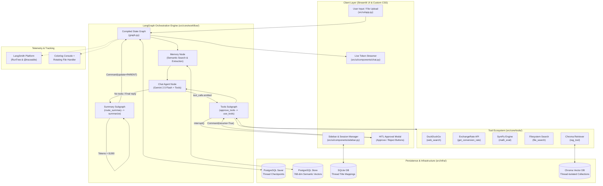
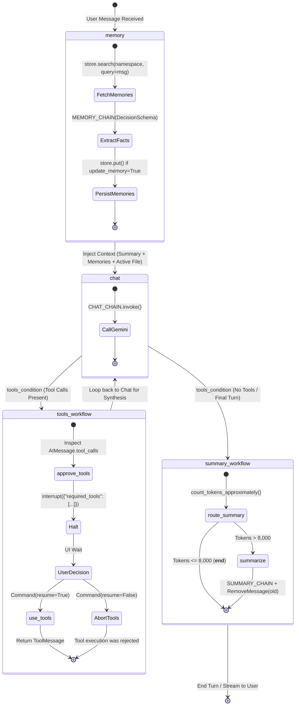

# Flaude – LangGraph based Agentic Chatbot

Flaude turns the typical LLM chat experience into a capable, personal assistant. Instead of relying on a plain prompt-reply loop, it uses LangGraph to orchestrate a smart agentic workflow—combining persistent memory, dynamic tool execution, and human-in-the-loop safeguards—to give you a chatbot that actually reasons, researches, and remembers.

## What makes it interesting

Under the hood it's a proper LangGraph agent, so it does a bit more than a plain prompt-reply loop:

1. **Memory**: Remembers facts about you across sessions using a semantic memory store. Not just conversation history — actual notes it keeps.
2. **Tools**: Web search, live currency rates, math solving, file search. It picks the right one and asks before using it.
3. **RAG**: Drop in a PDF or text file and ask questions about it.
4. **Human-in-the-Loop**: Confirms tool calls before running them, so nothing happens without your say.

## The Problem: Why Agentic Architecture Matters

Standard LLM wrappers fail in 5 major production areas:

| Production Failure Mode | Standard LLM Wrapper | Flaude Cognitive Architecture |
| :--- | :--- | :--- |
| **Stateless Amnesia** | Loses context across sessions; requires repeating facts | **Dual-Layer Memory**: `PostgresSaver` (thread checkpoints) + `PostgresStore` (768-dim semantic vectors) |
| **Autonomous Agent Liability** | Blind tool execution risking accidental cost/actions | **Human-in-the-Loop (HITL)**: Native `interrupt()` gate requiring human approval |
| **Context Window Explosion** | Crashes or naively truncates oldest messages | **Context Compactor**: Automated 8,000 token threshold with `RemoveMessage` state pruning |
| **Hallucinated Tasks** | Hallucinates multi-digit arithmetic or outdated forex | **Specialized Tool Ecosystem**: SymPy exact math, ExchangeRate API, live DuckDuckGo |
| **Unscoped Document RAG** | Single shared vector DB causing context bleeding | **Thread-Isolated RAG**: Language-aware syntax splitting + per-thread Chroma collections |

## Features

- **Agentic Workflow**: A LangGraph stateful agent that reasons, routes, and acts — not just generates.
- **Human-in-the-Loop**: Interrupts before every tool call so you can approve or cancel it.
- **Persistent Memory**: Cross-session checkpointing via PostgreSQL, plus a long-term semantic memory store.
- **RAG**: Upload PDFs or text files and query them using Chroma + Google Generative AI Embeddings.
- **Tool Use**: Web search, currency conversion, math solving (SymPy), and local file search.
- **Conversation Summarisation**: Automatically compresses old messages to stay within token limits — without losing context.
- **Auto Titles**: Generates a short, meaningful conversation title after your first message.
- **Multi-Session Sidebar**: Create, switch, and revisit conversations like a proper chat app.

## Tech Stack

| Component | Technology | Role |
| :--- | :--- | :--- |
| **Backend** | Python 3.11+, LangGraph | The agent orchestration engine |
| **LLM** | Google Gemini (`langchain-google-genai`) | Reasoning, generation, and tool selection |
| **Memory** | PostgreSQL, SQLite | Persistent session checkpointing |
| **Vector Store** | Chroma (`langchain-chroma`) | Semantic document retrieval |
| **Embeddings** | Google Generative AI Embeddings | Turning text into meaning |
| **Document Loaders** | PyPDF, LangChain | Ingesting PDFs and text files |
| **Tools** | DuckDuckGo, SymPy, Requests | Web, math, and currency |
| **UI** | Streamlit | A clean, reactive chat interface |
| **Observability** | LangSmith | Tracing agent runs end-to-end |
| **Ops** | uv, Ruff, MyPy | Fast packaging, linting, type safety |

## Architecture Deep Dive

### High-Level System Architecture



### LangGraph Workflow & Subgraphs (The Core State Machine)

The application compiles two specialized subgraphs into a master state machine in [`src/core/workflow/graph.py`](src/core/workflow/graph.py):



### State Schema & Delta Propagation

The state schema is defined in [`src/core/workflow/state.py`](src/core/workflow/state.py):

```python
class MessagesState(TypedDict):
    messages: Annotated[list[BaseMessage], add_messages]
    messages_summary: NotRequired[str]
```

#### How the State Machine Handles Data Mutations:
1. **`add_messages` Reducer**: LangGraph's prebuilt reducer handles both appending new messages (`AIMessage`, `HumanMessage`, `ToolMessage`) and deleting existing messages when a `RemoveMessage(id=...)` object is emitted.
2. **`messages_summary` Context Carrier**: An evolving string representing the compressed dialogue history prior to the active message window.
3. **Cross-Subgraph State Sync (`Command.PARENT`)**: In [`src/core/workflow/nodes.py`](src/core/workflow/nodes.py), the `summarize` node runs inside the `summary_subgraph`. To update the parent graph's state and prune messages globally, it issues:
   ```python
   return Command(
       update={
           "messages_summary": updated_summary,
           "messages": [
               RemoveMessage(id=str(message.id))
               for message in state["messages"][:-4]
           ],
       },
       graph=Command.PARENT,
   )
   ```

### Core Subsystems Deep Dive

#### 1. Dual-Layer Semantic Memory ([`src/core/capabilities/memory.py`](src/core/capabilities/memory.py))
Flaude separates short-term conversation state from persistent user facts:
- **Thread Checkpointing (`PostgresSaver`)**: Captures exact snapshots of the active graph state, allowing threads to survive server restarts and seamlessly resume interruptions.
- **Semantic Fact Store (`PostgresStore`)**: User memories are partitioned under namespace `("user_id", user_id)` and indexed with Google Generative AI embeddings (`models/gemini-embedding-2`, 768 dimensions).
- **Structured Extraction**: The `memory` node uses Pydantic structured output (`DecisionSchema`) to extract durable facts with snake_case keys (e.g. `profession`, `tech_stack`), ignoring transient small talk.

```python
class MemorySchema(BaseModel):
    key: str = Field(description="Unique snake_case identifier, e.g. 'profession'")
    value: str = Field(description="Complete factual statement optimized for semantic search")
    importance: float = Field(description="Float from 0.0 to 1.0 indicating criticality")

class DecisionSchema(BaseModel):
    update_memory: bool
    memories: list[MemorySchema]
```

#### 2. Human-in-the-Loop (HITL) Execution Gate ([`src/core/workflow/nodes.py`](src/core/workflow/nodes.py))
To prevent unmonitored execution of external tools:
1. **`approve_tools`**: Inspects `AIMessage.tool_calls` and triggers LangGraph's native `interrupt({"required_tools": [...]})`.
2. **`GraphInterrupt`**: Raises an interrupt exception, freezing graph state to PostgreSQL and unlocking Approve/Reject controls in the UI.
3. **Resumption**:
   - User clicks **Approve**: Streamlit sends `Command(resume=True)` $\rightarrow$ routes to `use_tools`.
   - User clicks **Reject**: Streamlit sends `Command(resume=False)` $\rightarrow$ routes to `__end__` with `"Tool execution was rejected."`

#### 3. Context Window Compactor & State Pruning ([`src/core/workflow/nodes.py`](src/core/workflow/nodes.py))
Prevents context window exhaustion without losing core background:
- **Token Threshold Gate (`route_summary`)**: Evaluates token consumption via `count_tokens_approximately()`. If `tokens <= 8,000`, it bypasses summarization (`__end__`).
- **Running Summary (`summarize`)**: When `tokens > 8,000`, `SUMMARY_CHAIN` condenses earlier messages into `messages_summary`.
- **Pruning**: Emits `RemoveMessage(id=...)` on oldest messages (`state["messages"][:-4]`) and updates `messages_summary` on the parent graph via `Command(update=..., graph=Command.PARENT)`.

#### 4. Thread-Isolated Language-Aware RAG ([`src/core/capabilities/rag.py`](src/core/capabilities/rag.py))
- **Syntax-Aware Code Ingestion**: Maps file extensions to LangChain `Language` enums (`.py`, `.md`, `.ts`, `.java`, `.cpp`, `.html`), preserving class and function AST boundaries.
- **Thread Isolation**: Chroma collections are named after `current_thread`. Uploading a new file to the active thread clears and recreates the collection, ensuring zero cross-thread context contamination.

#### 5. Tool Ecosystem ([`src/core/tools/`](src/core/tools/))

| Tool | Implementation | File | Purpose | Why Not Let LLM Guess? |
| :--- | :--- | :--- | :--- | :--- |
| `math_eval` | `sympy.sympify(expression)` | [`math.py`](src/core/tools/math.py) | High-precision arithmetic & algebra | Eliminates LLM math hallucinations; exact symbolic math engine. |
| `web_search` | `DuckDuckGoSearchRun()` | [`web.py`](src/core/tools/web.py) | Real-time web retrieval | Fetches live, post-training data without paid API quotas. |
| `get_conversion_rate` | ExchangeRate-API via `requests.get` | [`web.py`](src/core/tools/web.py) | Live foreign currency exchange | Forex rates fluctuate every minute; model weights cannot know current rates. |
| `file_search` | `Path.cwd().rglob(filename)` | [`files.py`](src/core/tools/files.py) | Local directory file search | Grants read-access to inspect local workspace files upon request. |
| `rag_tool` | Chroma VectorStore retriever | [`rag.py`](src/core/tools/rag.py) | Thread-isolated document retrieval | Dense semantic search over uploaded PDFs and codebases. |

## How It Works

Imagine you type: *"What is the current USD to JPY exchange rate?"*

1. **Chat Node**: Gemini reads your message and decides this is a factual lookup — it shouldn't guess. It selects the `get_conversion_rate` tool.
2. **Human-in-the-Loop**: Flaude pauses and asks: *"I'd like to call get_conversion_rate. Allow?"* You say yes.
3. **Tool Node**: The tool fires, hits the Exchange Rate API, and returns live data.
4. **Chat Node (again)**: Gemini reads the result and writes a clean, natural response.
5. **Memory Node**: Flaude checks if there's anything worth keeping — like *"User tracks currency rates"* — and stores it for next time.
6. **Summary Node** *(if needed)*: If the conversation is running long, older messages get compressed into a summary so nothing important gets dropped.

## Directory Structure

```text
Flaude/
├── .github/
│   └── workflows/
│       ├── ci.yml          # Ruff format, lint, and MyPy on every push
│       └── codeql.yml      # Weekly CodeQL security scan
├── configs/                # YAML config files (model params, paths, etc.)
├── src/
│   ├── core/
│   │   ├── agents/         # LLM chain definitions (chat, memory, summary)
│   │   ├── capabilities/   # Memory, RAG, and title generation logic
│   │   ├── tools/          # Web search, math, RAG tool, file search
│   │   └── workflow/       # LangGraph graph, node functions, state schema
│   ├── exception/          # Custom exception with file + line tracing
│   ├── infra/              # DB connections, LLM init, CSS loader
│   ├── logger/             # Rotating file + coloured console logger
│   └── ui/
│       ├── components/     # Streamlit chat and sidebar components
│       └── state.py        # Session state initialisation
├── main.py                 # Entry point
├── pyproject.toml
└── uv.lock
```

## Getting Started

### 1. Setup

Clone the repo and install everything with `uv`:

```bash
git clone
cd Flaude
uv sync
```

### 2. Configure

You'll need a Google API key and, optionally, keys for currency conversion and LangSmith tracing. Create a `.env` in the project root:

```env
GOOGLE_API_KEY="your_google_api_key"
EXCHANGE_RATE_KEY="your_exchangerate_api_key"   # optional, for currency tool
LANGSMITH_API_KEY="your_langsmith_api_key"      # optional, for tracing
```

Flaude uses **PostgreSQL** for persistent session checkpointing. Point it to a running Postgres instance via the connection string in `configs/`. If you just want to try it locally, the SQLite backend requires zero setup and works out of the box.

### 3. Run

```bash
uv run streamlit run main.py
```

Open **http://localhost:8501** and start chatting.
